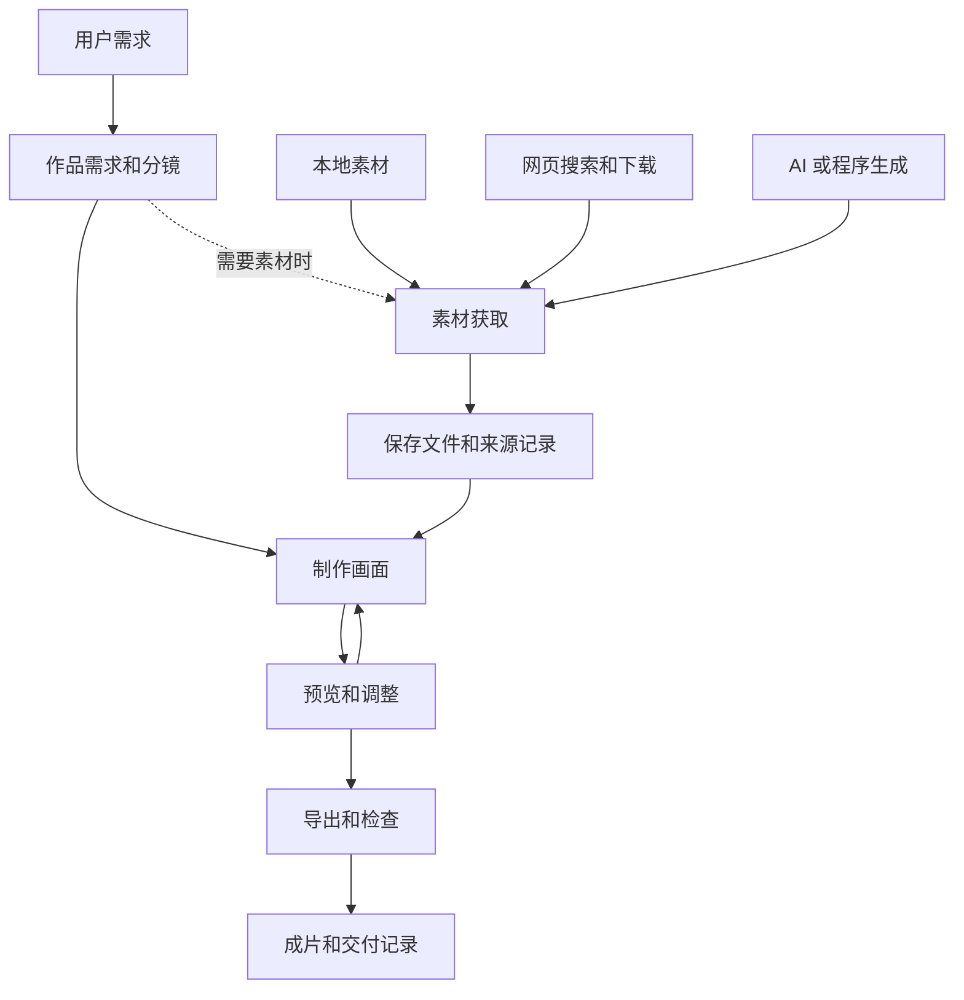

# Framecraft 个人 AI 动画创作仓库设计

Framecraft 是个人 AI 动画创作仓库。仓库保存作品需求、分镜、源码、素材和交付结果；AI 根据具体作品选择制作与素材获取方式，Remotion 是当前已经跑通的工具。

架构覆盖完整创作过程，日常使用按作品需要选择步骤。简单动画可以直接编写代码并预览，需要配乐的作品可以让 AI 从网页搜索和下载音乐，其他作品也可以使用本地素材或 AI 生成素材。所有流程最终汇合到作品源码、本地素材和交付文件。

第一版已在原 remotion-lab 上实施，目录与 package 名称改为 framecraft，Git 历史保留。当前实现包括多作品组织、Remotion 新建与预览、网页/本地音视频获取、素材恢复检查和按版本导出；后续能力保留接入边界，未用到的工具尚未安装。

## 设计原则

1. 以作品为基本单位。更换工具不会改变作品的身份、需求和素材记录。
2. 定义清楚输入、输出和文件归属，具体制作保留工具的原生代码。
3. 简单流程可以跳过不需要的步骤，复杂流程按需增加步骤；用户不必手工配置流水线或填写 JSON。
4. 优先让 AI 使用当前客户端已有的搜索、浏览器、下载、出图和文件编辑能力。反复使用且有明确收益的步骤，再沉淀为仓库脚本。
5. 新增能力时，新增对应说明、实现和一个真实例子；扩展位置先在文档中定义，依赖和代码按使用需要加入。

## 用户使用方式

用户可以直接说：

- “做一段 15 秒的文字动画，暂时不要音乐。”
- “做一段 30 秒的科技短片，你从网上找一首合适的无歌词背景音乐并下载。”
- “用我放进去的图片和音乐做一段竖屏动画。”
- “换掉这支片的音乐，画面先保持现在这样。”

AI 自动整理最小必要记录，完成制作，提供预览并根据反馈修改。简单片段的分镜直接写入 brief.md；有长旁白、多个镜头时，再拆出 script.md 或 storyboard.md。清晰的需求可以直接执行，不把每个阶段变成确认关卡。

## 能力划分和职责

| 能力       | 输入                     | 输出                     | 当前及后续实现方式                               |
| ---------- | ------------------------ | ------------------------ | ------------------------------------------------ |
| 需求与分镜 | 用户描述、参考、现有作品 | brief、文案、镜头安排    | AI 对话和仓库文档                                |
| 素材获取   | 素材需求、用途、已有资源 | 本地素材和来源记录       | 本地导入、网页搜索下载、AI 生成、程序生成        |
| 画面制作   | 分镜、素材、视觉要求     | 原生源码、预览或画面片段 | 当前 Remotion；以后按作品需要加入其他工具        |
| 音画编辑   | 片段、音乐、旁白、字幕   | 作品时间轴或合成结果     | 当前工具原生能力；复杂混合制作再加入独立合成步骤 |
| 检查       | 源码、素材、成片         | 检查结果与关键帧         | 类型检查、媒体探测、预览和实际播放               |
| 交付       | 检查通过的作品           | 成片、封面、必要说明     | 本地输出；其他交付渠道按请求增加                 |

这些是职责边界，不要求实现成六个服务。第一版主要由 AI、文件约定和原生工具命令串联。音乐搜索是素材获取，Remotion 使用音乐文件是制作，两者通过本地文件与素材记录衔接。



素材获取可以与画面制作交错进行。例如先用占位音乐看节奏，选定曲目后再精调。未取得的素材不能被记录为已经下载或已经用于成片。

## 目录与文件归属

```text
framecraft/
├── README.md                       # 使用入口与作品列表
├── AGENTS.md                       # 给 AI 的工作规范
├── package.json                    # 当前工具依赖和常用命令
├── package-lock.json
├── remotion.config.ts              # 当前制作工具的原生配置
├── docs/
│   ├── repository-design.md        # 架构与实施范围
│   └── music-sourcing.md           # 网页音乐获取流程
├── projects/
│   └── idea-to-motion/
│       ├── brief.md                # 需求与简短分镜
│       ├── project.json            # 作品身份与制作入口
│       ├── assets.json             # 实际引用的素材记录，有素材时建立
│       └── source/                 # 作品原生代码
├── public/
│   ├── shared/                     # 确实共用的字体等素材
│   └── idea-to-motion/
│       ├── owned/                  # 自有或允许随源码分发的素材
│       └── external/               # 下载或导入的第三方文件，默认忽略 Git
├── tools/
│   └── remotion/                   # 当前工具入口、作品注册及专属共用组件
├── scripts/                        # 根据实际流程增加的小脚本
└── out/
    └── idea-to-motion/
        └── v001/                   # 本次成片、关键帧和交付记录
```

这些目录已经按实际作品需要创建。共用组件先放在作品中，出现真实复用时再提取到对应工具目录；当前三支作品复用工具级字体。将来新增工具时，在 tools 下加入它的原生入口，作品源码仍归 projects。

public 是当前 Remotion 的素材入口。其他工具使用这些本地路径时由自己的运行方式处理，不要求把素材上传到统一服务。网页下载素材默认只保存在本地；来源记录可以进入 Git，原文件是否能随仓库公开分发需要独立确认。Git LFS 解决大文件存储，不能代替素材分发许可。[Pixabay 内容许可](https://pixabay.com/service/license-summary/)

## 最小数据约定

数据记录由 AI 或脚本维护。通用记录只描述身份、文件和结果，工具专属参数放在 tools 或作品原生源码中。

### 作品记录

project.json 保存作品 ID、标题和制作入口。以下为 Remotion 作品示例，所有相对路径都以作品目录为基准：

```json
{
  "schemaVersion": 1,
  "id": "idea-to-motion",
  "title": "一句话，动起来",
  "production": {
    "tool": "remotion",
    "options": {
      "compositionId": "IdeaToMotion"
    }
  }
}
```

compositionId 对应 tools/remotion 中的注册项。其他工具使用自己的 options，不复用 compositionId。画幅、帧率和执行时长由原生制作配置决定；brief.md 保存目标，交付记录保存实际测量结果，避免两份执行配置互相冲突。

### 素材记录

音乐、音效、图片、视频和字体共用一套基本字段：ID、类型、角色、本地路径、来源和必要使用说明。网页、生成、本地导入的差别放在 origin 中。

```json
{
  "schemaVersion": 1,
  "assets": [
    {
      "id": "bgm-main",
      "type": "audio",
      "role": "background-music",
      "path": "../../public/idea-to-motion/external/audio/track.mp3",
      "origin": {
        "kind": "web",
        "pageUrl": "https://music-source.example/track-page",
        "title": "示例曲目名称",
        "creator": "示例作者"
      },
      "usage": {
        "licenseUrl": null,
        "attribution": null,
        "evidencePath": null,
        "status": "unverified"
      }
    }
  ]
}
```

此示例尚不可用于交付：页面与曲目是占位内容，实际接入时填入真实文件和对应来源说明。文件存在、可解码以及适合目标用途是独立检查结果。

下载成功后增加实际时间、SHA-256、音频时长等事实字段。AI 生成素材记录所用工具、提示词和输出文件；本地导入记录原文件和已知用途。没有查到的数据可以留空，不凭印象填写许可证、BPM 或作者。

制作代码读取已确定的本地路径，素材 ID 用于记录和追踪。第一版不要求所有工具实现新的素材 URI 协议。以后增加查询或复用功能时，可以直接读取这份记录。

### 交付记录

每次正式导出在 out/作品/v001 下保存 final.mp4、需要的关键帧和 delivery.json。记录内容至少包含作品 ID、制作工具、成片路径、实际时长、画幅、帧率、音轨和所用素材 ID。

源代码版本、是否有未提交修改和依赖版本也写入记录。当前导出脚本会保存源码、共用字体和目标作品素材的快照，并从快照渲染；快照包含依赖锁文件，不包含 node_modules。来源记录用于追踪，不把一个 Git SHA 当作包含未提交修改的完整快照。生成素材重新生成后作为新版本保存，避免覆盖已用于旧成片的文件。

## 音乐获取与音画编辑

音乐是一种素材，来源可以是用户提供、作品已有、网页获取、AI 生成或程序合成。用户指定来源时按指定方式执行；未指定时，优先复用合适的已有素材，再根据作品需要搜索网页或使用可用生成工具。

网页音乐的流程为：理解风格和用途，搜索候选曲目，查看曲目页面与使用说明，试听，下载原始文件，检查媒体信息，登记来源，接入时间轴并检查完整成片。具体操作见 [音乐获取流程](music-sourcing.md)。

搜索和选曲由当前 AI 客户端完成，不要求每个音乐网站都先写 API 适配器。普通 HTTP(S) 下载、本地音视频导入、媒体检查和来源登记已由 scripts/assets.mjs 实现；需要登录或特殊页面操作的网站，使用正常可用的客户端能力，失败时换可用来源或报告具体缺失条件。

制作时可以选择片段、调低音量、淡入淡出，并在旁白出现时降低背景音乐。是否循环和如何剪辑由曲目、目标用途与时间轴决定。来源改变后，只替换本地文件及相应记录；具体剪辑参数仍留在作品源码。[Remotion Audio](https://www.remotion.dev/docs/media/audio)

## 简单流程和扩展流程

| 场景                   | 需要的步骤                             | 可以跳过的步骤                 |
| ---------------------- | -------------------------------------- | ------------------------------ |
| 无素材的短文字动画     | 简短需求、编写源码、预览、导出检查     | 素材搜索、下载、配音、独立合成 |
| 使用已有音乐的动画     | 引用本地音乐、制作、音画检查           | 网页搜索、音乐生成             |
| 配乐由 AI 从网上寻找   | 音乐搜索试听、下载登记、制作、音画检查 | 模型 API、额外动画引擎         |
| 图片与配音的讲解视频   | 导入或生成素材、旁白、字幕、制作、检查 | 用不到的三维或数学工具         |
| 多种工具制作的混合短片 | 各工具输出片段、安排合成、检查交付     | 任一与作品无关的能力           |

复杂作品可以独立保存旁白、字幕和剪辑安排。简单作品继续使用工具自己的时间轴，不强迫所有作品填一份通用 edit.json，也不实现统一动画语言。

更新音乐只重新执行素材与音画检查；修改文字只处理画面和相关旁白；已保存且满足需求的素材直接复用。第一版由 AI 根据文件和记录判断，只有批量重复制作需要时再增加自动失效与缓存逻辑。

## 扩展方式

扩展时保持作品身份、本地素材记录和交付结果三个边界稳定。

| 新能力             | 接入位置                               | 需要保持的约定                           |
| ------------------ | -------------------------------------- | ---------------------------------------- |
| 新音乐或图片网站   | 素材获取说明或下载脚本                 | 输出本地文件与真实来源记录               |
| 新的出图或配音模型 | 当前 AI 客户端工具；需要时增加调用脚本 | 输出本地素材，记录工具和生成参数         |
| 新的动画制作工具   | tools 下的工具入口和项目 source        | 保留原生代码，输出可预览的作品或媒体片段 |
| 独立后期合成       | 作品剪辑源码或 tools 下的合成入口      | 消费已有片段，输出成片及实际媒体信息     |
| 更多风格           | 可复用组件、字体和参考说明             | 作品可以选择或覆盖风格                   |
| 网页作品管理界面   | 已有作品与交付记录之上的界面           | 复用现有文件和命令入口                   |
| 批量渲染或远程任务 | 现有导出入口之外的执行方式             | 保留作品和产物约定，不改写创作格式       |

第一版可以通过一段制作说明接入新能力，重复使用后再补脚本或小模块。架构约定不依赖数据库、插件注册器或常驻任务服务；这些实现只有出现对应运行需求时才加入。

## 失败处理与检查

获取步骤没有成功时，保留候选和具体失败原因，其他可用素材来源仍可以继续尝试。用户明确要求指定曲目时，不静默换成程序音乐；任何替换都记录实际使用的来源。

导出只读取已经准备好的本地素材，不在逐帧渲染过程中重复搜索、下载或生成。下载后检查文件类型、可解码性和时长；正式导出前检查路径和素材用途记录；导出后查看关键帧，核对实际媒体信息并完整播放检查音画。

不同工具各自检测依赖和能力。当前 Remotion 随附 FFmpeg 的过滤器数量有限，不能直接当作完整后期安装；独立合成若需要字幕或其他过滤器，在使用前检测对应 FFmpeg 能力。

## 第一版实施范围与验收

第一版实现一个完整但可跳过步骤的真实流程：

1. 整理通用仓库名称、作品目录、AGENTS.md 和原生工具入口，将现有小样迁移为第一支作品。
2. 补充最小作品记录、按需素材记录，以及按版本保存成片和交付结果的方式。
3. 新增一支有背景音乐的小作品，由 AI 真正完成网页搜索、试听或音频检查、下载、来源记录、Remotion 接入与成片检查。
4. 验证一支无音乐的短动画可以直接制作，不需要音乐流程或外部服务。

验收时分别证明：现有动画迁移后可运行；网页音乐实际保存到本地且成片含所选音乐；来源和使用说明可追踪；两个作品互不干扰；简单流程能跳过素材获取；新素材来源无需改写作品组织方式。

后续按真实作品增加生成图片、旁白、字幕、其他动画工具和合成步骤。这里定义的是扩展边界，尚未声明这些能力已经接入。

第一版的实际作品、命令检查与音频验证见 [验证记录](verification.md)。
